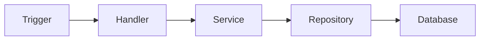
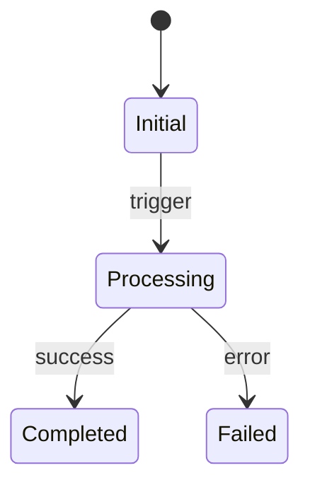

# Document Feature

Generates concise, AI-optimized feature
documentation. The doc describes the FEATURE
(what it does, how it works) — not the story.

**Naming:** File name = meaningful feature name
derived from story title or ACs. Not story IDs.

**Output:** `docs/features/<feature-name>.md`

---

## Phase 1: Context Gathering

### 1a: Resolve story (if available)

Look for linked story via:
1. User provides ID
2. Branch name pattern (`#12345`, `AB-1234`)
3. Ask user

If found, fetch context:

**GitHub:**
```bash
gh issue view <number>
```

Use issue/story title + acceptance criteria to
understand the feature's goal. Do NOT copy them into
the doc.

### 1b: Derive feature name

From story title or ACs, extract a short
descriptive name for the feature:

- Good: `order-cancellation-flow`
- Good: `vehicle-telemetry-ingestion`
- Good: `role-based-dashboard-access`
- Bad: `US-12345`
- Bad: `feature-branch-work`
- Bad: `new-endpoint`

The name should describe WHAT the feature does
or achieves.

---

## Phase 2: Branch Analysis

### 2a: Identify changes

```bash
git merge-base HEAD main
git diff --name-only $(git merge-base HEAD main)
git diff --stat $(git merge-base HEAD main)
```

### 2b: Categorize changes

Group files by role:

| Category | Patterns |
|----------|----------|
| API | `*Controller*`, `*Route*`, `*Handler*` |
| Services | `*Service*`, `*UseCase*` |
| Domain | `*Entity*`, `*Model*`, `*DTO*` |
| Data | `*Repository*`, `*Dao*`, `*Migration*` |
| Config | `*Config*`, `*.yml`, `*.properties` |
| Tests | `*Test*`, `*Spec*`, `*.test.*` |
| UI | `*.vue`, `*.tsx`, `*.jsx` |

### 2c: Read key files

For each category with changes:
- Read to understand purpose
- Identify entry points and exit points
- Note new public APIs or interfaces
- Track data transformations

Skip test file contents — scan names only.

---

## Phase 3: Architecture Understanding

### 3a: Trace data flow

1. What triggers this feature?
2. What data comes in? (shape, source)
3. What transformations happen?
4. What gets persisted or sent?
5. What response goes back?

### 3b: Identify state transitions

- Status fields / enums that change
- Lifecycle events
- Conditional branches on state
- Error states and recovery

### 3c: Map dependencies

- External services called
- Database tables affected
- Events published/consumed
- Shared libraries used

---

## Phase 4: Document Generation

**File:** `docs/features/<feature-name>.md`

Generate using this template:

```markdown
# <Feature Name>

<2-3 sentences: what this feature does and
why it exists. No story references — describe
the capability itself.>

## Goal

<What problem this solves. What the user/system
gains. Derived from ACs but stated as feature
purpose, not as acceptance criteria.>

## Key Files

| File | Role |
|------|------|
| `path/to/file` | <one-line purpose> |

## Data Flow



<Adapt to actual flow. Max 8 nodes.>

## State Transitions



<Only if feature has meaningful states.
Skip for simple CRUD.>

## API

| Method | Path | Purpose |
|--------|------|---------|
| POST | `/api/...` | <what it does> |

<Only if feature exposes/modifies endpoints.>

## Events

| Event | Payload | When |
|-------|---------|------|
| `event.name` | `{key fields}` | <trigger> |

<Only if feature publishes/consumes events.>

## Domain Rules

- <Rule 1: invariant or constraint>
- <Rule 2: business logic enforced in code>

<Non-obvious rules only. Skip if feature is
purely structural.>

## Error Handling

| Scenario | Behavior |
|----------|----------|
| <case> | <what happens> |

<Only critical/non-obvious error paths.>

## Edge Cases

- <Edge case 1>
- <Edge case 2>

## Dependencies

- **Requires:** <services, libs, infra>
- **Consumed by:** <downstream features>
```

**Section rules:**
- Remove any section that doesn't apply
- Never leave a section empty
- No story IDs, ticket numbers, or AC text
  in the output
- Describe the feature as if the story didn't
  exist — someone reading this should
  understand the feature without external
  issue trackers

---

## Phase 5: Review & Place

### 5a: Self-review checklist

- [ ] Feature name is descriptive (no IDs)
- [ ] No story references in doc body
- [ ] No large code snippets (max 3 lines)
- [ ] Mermaid diagrams render-valid
- [ ] Key files list covers entry points
- [ ] Empty sections removed
- [ ] No placeholder text

### 5b: Determine output location

Default: `docs/features/<feature-name>.md`

If updating existing feature: find and update
the existing doc (don't create duplicates).

### 5c: Write and verify

1. Write file
2. Verify mermaid syntax
3. Show summary: file path, sections included

---

## Phase 6: Documentation Ecosystem Maintenance

After feature doc is written, maintain the
broader docs ecosystem.

### 6a: Artifact Analysis Gates

| Gate | Check | Action |
|------|-------|--------|
| Flow? | New participant/route/call | Mermaid in `docs/flows/` |
| Decision? | New pattern/lib/arch | ADR in `docs/decisions/` |
| Lesson? | Non-trivial fix | Note in `docs/notes/` |

SKIP gate only if answer is clearly NO.

### 6b: Update `AI-CONTEXT.md`

**Rule:** AI-CONTEXT.md = facts + navigation.

Update ONLY if high-level facts changed:

1. Add link to new feature doc
2. Update domain glossary if new terms
3. Update integrations if new services
4. Update entities if new domain objects

**Anti-bloat:**
- Never duplicate feature doc content — link
- Structured lists only, no prose
- Remove stale entries when replaced

**Format:**
```markdown
## Features

- [Order Cancellation](docs/features/order-cancellation-flow.md)
- [Telemetry Ingestion](docs/features/vehicle-telemetry-ingestion.md)
```

### 6c: Update `README.md` (if needed)

Only if changes affect:
- Environment variables
- Setup steps
- Runtime dependencies

### 6d: Learning Capture

Ask: "Reusable lesson from this work?"
- If NO: skip
- If YES: capture in `docs/notes/<topic>.md`

---

## Rules

- **Feature-first** — doc describes the
  capability, not the ticket
- **Meaningful names** — file named for what
  it does, never by story ID
- **Concise over complete** — brevity wins
- **No code walls** — reference by path, max
  3 inline lines
- **Mermaid for flows** — diagrams over prose
- **WHAT and WHY, not HOW** — code shows how
- **Skip empty sections** — omit, don't leave
  blank
- **One doc per feature** — update in place,
  never create duplicates

## Anti-Bloat Enforcement

- Output ONLY file content
- Forbidden: intro/outro sentences
- Forbidden: story IDs, AC text, ticket refs
- AI-CONTEXT.md grows only by pointers
- Feature docs replace, never append

## Anti-Patterns

- Putting story IDs or AC text in feature docs
- Naming docs by ticket number
- Pasting entire functions or classes
- Describing obvious CRUD without value
- Implementation details that change often
- Diagrams with >8 nodes
- Framework boilerplate as "key files"
- Inventing rules not in code or story
- Leaving placeholders in output
- Letting AI-CONTEXT.md become a wiki
- Creating docs without linking from
  AI-CONTEXT.md
